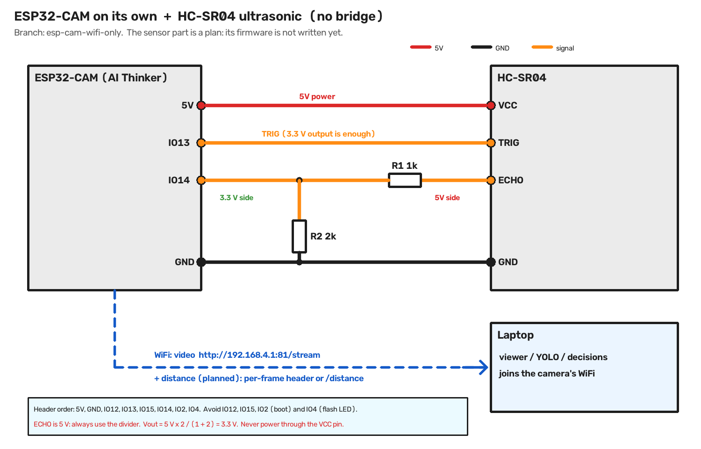
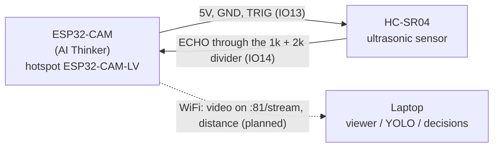

# ESP32-CAM on its own: wiring for the HC-SR04 ultrasonic sensor

Branch `esp-cam-wifi-only`. This is the plan for a healthy ESP32-CAM that streams over its own WiFi, with no
bridge board. The camera hosts the hotspot `ESP32-CAM-LV` and the laptop joins it.

**Status:** this is a plan. The firmware for the sensor is **not written yet**, and the wiring has **not been
tested**, because the only camera available has a damaged WiFi radio. The existing firmware (video only) compiles
and is ready for a new board.



## How the data flows



```
 ESP32-CAM                                                HC-SR04
 +-----------+                                            +---------+
 | 5V    o---+------------------- red ---------------------+-o VCC   |
 | IO13  o---+------------------- orange -------------------+-o TRIG  |
 | IO14  o---+-----------+-------- orange ---[1k]-----------+-o ECHO  |
 |           |           |                                  |         |
 |           |         [2k]                                 |         |
 | GND   o---+-----------+------------------ black ---------+-o GND   |
 +-----------+                                              +---------+
```

## Wiring table

| HC-SR04 pin | Wire to | ESP32-CAM pin | Notes |
|---|---|---|---|
| **VCC** | red | **5V** | the sensor needs 5 V; draws about 15 mA |
| **GND** | black | **GND** | common ground |
| **TRIG** | orange | **IO13** | a 3.3 V output is enough to trigger it |
| **ECHO** | through the divider | **IO14** | the echo output is **5 V**, so it needs the divider below |

All four connections are on **one header** of the camera: `5V, GND, IO12, IO13, IO15, IO14, IO2, IO4`
(the header opposite the `U0T` one). Read the labels with the lens facing up.

## Why IO13 and IO14

| Pin | Use for the sensor? | Reason |
|---|---|---|
| **IO13** | yes | free, no boot function |
| **IO14** | yes | free, no boot function |
| IO12 | avoid | boot pin: a high level at power-up can stop the board from booting |
| IO15 | avoid | boot pin (also silences the boot log) |
| IO2 | avoid | boot pin (flash mode) |
| IO4 | avoid | drives the bright flash LED, which the web server also uses |
| IO16 | not available | used by the PSRAM |
| IO0, IO5, IO18 to IO27, IO32 to IO39 | not available | camera and PSRAM signals |

## Resistor advice: the voltage divider on ECHO

The HC-SR04 echo pin outputs **5 V**. The ESP32 pins accept at most about **3.3 V**. Connecting echo straight to
a pin can damage the pin.

```
 HC-SR04 ECHO ----[ R1 ]----+---- ESP32-CAM IO14
                            |
                          [ R2 ]
                            |
                           GND

 Vout = 5 V x R2 / (R1 + R2)
```

| R1 (ECHO to IO14) | R2 (IO14 to GND) | Vout | Verdict |
|---|---|---|---|
| **1 kΩ** | **2 kΩ** | **3.33 V** | best choice |
| 2.2 kΩ | 3.3 kΩ | 3.0 V | good |
| 1 kΩ | 1.5 kΩ | 3.0 V | good |
| 10 kΩ | 20 kΩ | 3.33 V | works, but slower edges; avoid above 10 kΩ |
| 1 kΩ | 1 kΩ | 2.5 V | too low, the ESP32 may miss the signal |

- **Only have 1 kΩ resistors?** Use three: one for R1, and two in series for R2.
- **Ordinary 5 % resistors are fine.** TRIG needs no resistor.
- **A 3.3 V sensor** (HC-SR04P or a "3.3 V compatible" board) needs no divider. Power it from the `3V3` pin.

## How the distance would reach the laptop (planned)

| Option | How | Good for |
|---|---|---|
| **Per-frame header** | add `X-Distance-cm` to the header that each video frame already carries (it has `X-Timestamp` today) | every picture arrives with the distance from the same moment, ideal for YOLO plus distance |
| **JSON page** | a small page such as `http://192.168.4.1/distance` that the laptop polls 10 to 20 times a second | simple, does not touch the video code |

In both cases the sensor is read in a **separate background task** and the value is cached, so the camera is
never delayed. Use an interrupt or a short timeout instead of a long blocking read.

## Power and safety checklist

| Do | Don't |
|---|---|
| Power the camera from its **5V pin** (4.9 to 5.1 V) | Never power it through **VCC**: that is the 3.3 V rail, and 5 V there can damage the ESP32 |
| Add a **100 to 470 µF capacitor** across the camera 5V and GND (stripe = negative to GND) | Don't connect **IO0 to GND**: it puts the camera into flash mode |
| Keep wires short and connections firm | Don't connect the sensor's 5 V ECHO to a pin without the divider |
| Keep the sensor and the camera facing the same way | Don't rely on the sensor alone: it sees a cone of 15 to 30 degrees, not a point |

Current draw: the camera about 150 to 250 mA (up to about 300 mA while the WiFi transmits), the sensor about
15 mA. Use a 5 V supply that gives at least 1 A.
