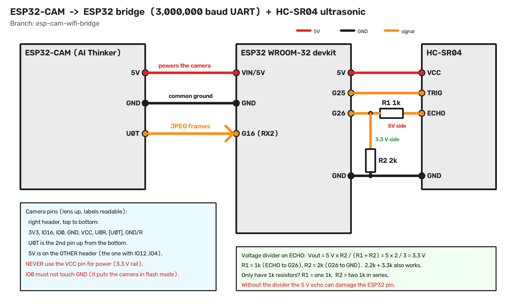
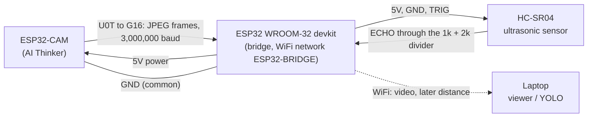

# ESP32-CAM bridge: wiring and parts

Branch `esp-cam-wifi-bridge`. The camera sends its JPEG frames over a wire (UART) to an ESP32 devkit, and the
devkit sends them to the laptop over its own WiFi network. The ultrasonic sensor (HC-SR04) is planned to plug
into the same devkit.

**Status:** the camera-to-bridge wiring (section 1) is built and tested. The HC-SR04 wiring (section 2) is a plan:
the firmware for it is not written yet.



## How the data flows



```
 ESP32-CAM                      ESP32 devkit (bridge)                 HC-SR04
 +-----------+                  +--------------------+               +---------+
 | 5V    o---+------ red -------+--o VIN/5V       5V o+------ red ----+-o VCC   |
 | GND   o---+------ black -----+--o GND          G25 o+----- orange -+-o TRIG  |
 | U0T   o---+------ orange ---->--o G16 (RX2)    G26 o+-----+--[1k]--+-o ECHO  |
 +-----------+   (frames)       |                     |      |       |         |
                                |                     |     [2k]     |         |
                                |                 GND o+-----+-------+-o GND   |
                                +--------------------+               +---------+
```

## 1. ESP32-CAM to the bridge (built, tested)

| ESP32-CAM pin | Wire to | ESP32 devkit pin | Purpose |
|---|---|---|---|
| **5V** | red | **VIN / 5V** | powers the camera from the devkit (measured 4.9 V at the camera) |
| **GND** | black | **GND** | common ground (the signal needs it) |
| **U0T** (GPIO1, TX) | orange | **G16** (RX2) | JPEG frames, one direction, camera to bridge |

Leave unconnected: the camera's `VCC`, `U0R`, `IO0` and every other pin.

**Finding the pins**

| Board | How to find it |
|---|---|
| ESP32-CAM | Lens facing up, read the printed labels. The right-hand header, top to bottom, is `3V3, IO16, IO0, GND, VCC, U0R, U0T, GND/R`. **U0T is the 2nd pin up from the bottom.** The **5V** pin is on the *other* header (the one with `IO12 … IO4`). |
| Devkit, left row (USB at the top) | `CLK, SD0, SD1, G15, G2, G0, G4,` **`G16`**`, G17, G5, G18, G19, GND, G21, RXD, TXD, G22, G23, GND`. G16 is the 8th pin from the USB end. |
| Devkit, right row (USB at the top) | `5V/VIN, GND, SD3, SD2, G13, GND, G12, G14, G27,` **`G26`**`,` **`G25`**`, G33, G32, G35, G34, SN, SP, EN, 3V3`. The first label at the USB end was hard to read in the photo, so check the print for `5V` or `VIN`. |

**Settings that must match**

| Setting | Camera firmware | Bridge firmware |
|---|---|---|
| Baud rate | `SERIAL_BAUD 3000000` | `CAM_BAUD 3000000` |
| Receive pin | (not used) | `RX_PIN 16` |
| Frame format | `A5 5A C3 3C`, 4-byte length, JPEG | same |

4,000,000 baud failed on jumper wires (data errors). 3,000,000 ran clean.

## 2. HC-SR04 to the bridge (planned)

| HC-SR04 pin | Wire to | ESP32 devkit pin | Notes |
|---|---|---|---|
| **VCC** | red | **5V / VIN** | the sensor needs 5 V |
| **GND** | black | **GND** | |
| **TRIG** | orange | **G25** | a 3.3 V output is enough to trigger it |
| **ECHO** | through the divider | **G26** | the echo output is **5 V**, so it needs the divider below |

Pins to avoid on the devkit: `G16` (the camera link), `G0, G2, G12, G15` (they affect booting), and `G6 to G11`
(they belong to the flash chip).

## Resistor advice: the voltage divider on ECHO

The HC-SR04 echo pin outputs **5 V**. The ESP32 pins accept at most about **3.3 V**. Connecting echo straight to
a pin can damage the pin. A two-resistor divider brings 5 V down to 3.3 V:

```
 HC-SR04 ECHO ----[ R1 ]----+---- ESP32 G26
                            |
                          [ R2 ]
                            |
                           GND

 Vout = 5 V x R2 / (R1 + R2)
```

| R1 (ECHO to G26) | R2 (G26 to GND) | Vout | Verdict |
|---|---|---|---|
| **1 kΩ** | **2 kΩ** | **3.33 V** | best choice |
| 2.2 kΩ | 3.3 kΩ | 3.0 V | good |
| 1 kΩ | 1.5 kΩ | 3.0 V | good |
| 10 kΩ | 20 kΩ | 3.33 V | works, but slower edges; avoid above 10 kΩ |
| 1 kΩ | 1 kΩ | 2.5 V | too low, the ESP32 may miss the signal |

- **Only have 1 kΩ resistors?** Use three: one for R1, and two in series for R2 (series resistors add: 1 k + 1 k = 2 k).
- **Ordinary 5 % resistors are fine.** Exact values do not matter.
- **TRIG needs no resistor.**
- **A 3.3 V sensor** (HC-SR04P or a "3.3 V compatible" board) needs no divider. Power it from the devkit `3V3` pin.

## Power and safety checklist

| Do | Don't |
|---|---|
| Power the camera from its **5V pin** (4.9–5.1 V) | Never power it through **VCC**: that is the 3.3 V rail, and 5 V there can damage the ESP32 |
| Add a **100–470 µF capacitor** across the camera 5V and GND (stripe = negative to GND) | Don't connect **IO0 to GND**: it puts the camera into flash mode |
| Keep the signal wires short and the connections firm (a bad contact once cost hours) | Don't connect the sensor's 5 V ECHO to a pin without the divider |
| Share one common GND between camera, devkit and sensor | Don't ask for more than 3 Mbaud on jumper wires |

Current draw: the camera needs about 150–250 mA, the devkit about 150–250 mA with WiFi on, and the sensor about
15 mA. A laptop USB-C port supplies that. On the car use a powerbank that gives 1 A or more.
